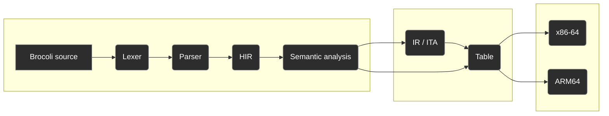

<div align="center">
  <picture>
    <source media="(prefers-color-scheme: dark)" srcset="docs/images/brocoli-dark.svg">
    
  </picture>
</div>

<br>

> Dual-licensed under Apache License v2 and GPL v3, see details [here](#licensing).

**Brocoli** is a systems language derived from B, the predecessor of C. It extends B with a type system by inference, tagged unions, kernel syscalls **that do not depend on libc**, and other improvements. Most B programs are valid Brocoli, and source files keep the `.b` extension.

**Credence** is the Brocoli compiler, written in modern C++, with backends for x86-64 and ARM64 on Linux and Darwin.

* Language grammar: [here](credence/language/grammar.lark)
* B, where Brocoli started: [here](https://www.nokia.com/bell-labs/about/dennis-m-ritchie/btut.pdf)
* Building, cross-compilation, and the test suite: [here](development.md)

#### Check out the <a href="https://jahans.blog/tag/credence/">blog series</a>!

## Example

[`examples/5.b`](examples/5.b) uses the syscalls available on every platform - `write`, `getpid`, `getppid`, `getuid`, `umask`, `dup`, and `close` - and prints their results with the standard library `printf`.

```C
main(argc, argv) {
  auto pid, mask, fd, n;
  extrn banner, report;

  write(1, banner, 32);
  print("\n");
  rule(32);

  // the process and its parent
  pid = getpid();
  printf("pid %d, parent %d, uid %d\n", pid, getppid(), getuid());

  // umask twice
  mask = umask(63);
  printf("umask was %d, then %d\n", mask, umask(mask));

  // a duplicate of stdout
  fd = dup(1);
  n = write(fd, report, 33);
  close(fd);
  printf("wrote %d bytes to descriptor %d\n", n, fd);

  if (argc > 1)
    greet(argv[1], argc - 1);

  rule(32);
}

// a horizontal rule
rule(width) {
  auto i;
  i = 0;
  while (i < width) {
    write(1, "#", 1);
    i++;
  }
  write(1, "\n", 1);
}

greet(name, count) {
  printf("hello, %s, you passed %d argument%s\n", name, count, plural(count));
}

plural(count) {
  if (count == 1)
    return("");
  return("s");
}

banner "### credence syscall example ###\n";

report "written to a duplicate of stdout\n";
```

```bash
credence -t arm64 -o syscalls examples/5.b
./syscalls world
```

Use `-t x86_64` on an x86-64 host. The first argument after the program name is printed by `greet`:

```
### credence syscall example ###
################################
pid 83864, parent 83559, uid 501
umask was 18, then 63
written to a duplicate of stdout
wrote 33 bytes to descriptor 3
hello, world, you passed 1 argument
################################
```

## The Language

These features are extensions that were not in the original B language specification.

* **Strongly typed by type inference**, see the [type system](#type-system)
* **Tagged unions**, see [unions](#unions)
* Syscalls and a standard library with no libc, see [below](#standard-library-and-syscalls)
* Compile-time out-of-range checks on vectors and pointer arithmetic
* Vectors may be non-homogeneous, but the type of each element is determined by its initial value and may not be changed
* C style `float` and `double` literals, e.g. `5.55f`, and C style constant literals
* Identifiers may be up to 16 characters, B allows 8
* `argc` and `argv` support
* C++ style comments
* Logical and bitwise operators, and operator precedence, behave like C

The following differ from B:

* `goto` and labels are not supported, use control structures
* A `switch` condition is always enclosed in `(` and `)`
* A binary operator may not be used directly after the `=` operator

### Type System

The original B has no types, but Brocoli is strongly typed by type inference. A [semantic pass](/credence/language/hir/table.h) over the HIR gives each variable a storage - a scalar, or a pointer and the type it points to - and a type from its first assignment, such as `int`, `long`, `float`, `double`, `char`, or `string`. Every assignment after it is checked at compile time.

* Uninitialized variables are an internal `null` type until their first assignment
* A `word` is a machine word, such as a parameter, a call result, or a binary expression, and is compatible with every type
* Once a scalar has a type it may not be assigned another, e.g. `x = 10; x = 3.14;` is an error
* Once a pointer points to a type it may **only** point to that type
* An assignment through a null pointer, `*m = 5;`, makes `m` a pointer to `int`, and a dereference of `m` before it is a null pointer dereference
* Vector offsets and pointer arithmetic are checked for out-of-range access at compile time
* A function may return from more than one statement, but each return value must be the same type
* A parameter that any call passes a pointer, a string, or an element of `argv` is a pointer, even when it isn't declared `*name`

An index past the end of a vector is a compile-time error:

```C
main() {
  extrn strings;
  print(strings[10]);
}

strings [3] "Good afternoon", "Good morning", "Good evening";
```

```
Credence Error ::
  Credence could not compile source:
    on symbol 'strings[10]'
    with: "invalid out-of-range vector access 'strings' at index '10' in function 'main'"
```

See details [here](/credence/language/README.md#semantic-analysis).

### Unions

A union is defined with the syntax of C, and is tagged like an enum in Rust - each member is a tag, and a union holds one tag at a time. The type of a tag is determined by its initial value, as with the elements of a vector, and a tag with a list of values is a tuple of their types.

```C
union value {
  integer 0,
  real 0.0f,
  pair (0, 0)
};

union value unit;

main() {
  union value v;
  v.real = 2.5f;
  if (v is value.real) {
    printf("real %f\n", v.real);
  }
}
```

* `union value { ... };` defines a union, and the comma between tags is optional
* `union value v, w;` declares union variables in a function, or as a global definition
* An assignment to a tag, `v.real = 2.5f;`, makes it the active tag of `v`
* `v is value.real` is true when `real` is the active tag of `v`
* A tag may only be assigned a value of its type

See details [here](/credence/language/README.md#unions).

### Standard Library and Syscalls

Credence provides a few useful [standard library](credence/target/common/runtime.h) functions that **do not** depend on libc or an external runtime. The standard library is hand-written assembly, pre-compiled in `stdlib/` for each platform and ISA:

* `printf` - a format string and up to 8 arguments, `%d`, `%f`, `%g`, `%s`, `%b`, and `%c`
* `print` - a string or buffer, with its length resolved at compile time
* `putchar` - writes a single byte character to stdout
* `getchar` - reads a single byte character from stdin

In addition, an interface for kernel syscall tables such as `write(3)` is available for each platform, see details [here](credence/target/common/syscall.h). The syscalls in `examples/5.b` are available on every platform.

## The Compiler

Credence works in 3 stages:

* A Lexer generated with [re2c](https://github.com/skvadrik/re2c) that is used with a hand-written [Recursive-Descent Parser](/credence/language/parser.h), whose expressions are lowered into a [High Level Intermediate Representation or HIR](/credence/language/hir/hir.h) - a tree of expression kinds with `(value:type:size)` tuples
    * See details [here](/credence/language/README.md)
* An IR (intermediate representation) I've named [Instruction Tuple Abstraction or ITA](credence/ir/README.md) - a linear 4-tuple set of platform-agnostic instructions that represent program flow and scope
    * See details [here](/credence/ir/README.md)
* The target platforms, instruction selection and ISAs - x86-64 and ARM64 for Linux and Darwin
    * See details [here](/credence/target/README.md)



### Targets

The generated machine code is compliant with the Application Binary Interface (ABI) for System V, and the ARM64 Procedure Call Standard (PCS).

* Linux - ARM64 (AArch64) and x86-64
* Darwin - ARM64 (AArch64) and x86-64 (Intel)

**Note**: Windows is not supported.

### Intermediate Representation

**Note**: The default compile target is the IR, [ITA](credence/ir/README.md).

The `rule` function of the example:

```C
rule(width) {
  auto i;
  i = 0;
  while (i < width) {
    write(1, "#", 1);
    i++;
  }
  write(1, "\n", 1);
}
```

Produces:

```asm
__rule(width):
 BeginFunc ;
    LOCL i;
    i = (0:int:4);
_L2:
_L4:
    _t5 = i < width;
    IF _t5 GOTO _L3;
    _p10_29 = (1:int:4);
    _p11_30 = ("\n":string:1);
    _p12_31 = (1:int:4);
    PUSH _p12_31;
    PUSH _p11_30;
    PUSH _p10_29;
    CALL write;
    POP 24;
    _t13 = RET;
_L1:
    LEAVE;
_L3:
    _p6_26 = (1:int:4);
    _p7_27 = ("#":string:1);
    _p8_28 = (1:int:4);
    PUSH _p8_28;
    PUSH _p7_27;
    PUSH _p6_26;
    CALL write;
    POP 24;
    _t9 = RET;
    i = ++i;
    GOTO _L2;
 EndFunc ;
```

### Code Generation

The `_L3` loop body of `rule` above, on ARM64 Darwin. The syscall number of `write` is in `x16`, and `svc` enters the kernel. The stack frame makes calls, so the local `i` is on the stack:

```asm
._L3__rule:
    mov w0, #1
    adrp x1, ._L_str2__@PAGE
    add x1, x1, ._L_str2__@PAGEOFF
    mov w2, #1
    mov x16, #4
    svc #0x80
    mov w8, w0
    ldr w10, [sp, #20]
    add w10, w10, #1
    str w10, [sp, #20]
    b ._L2__rule
```

Check out additional code generation examples in the [arm64 test suite](/test/arm64/expected/) and [x86_64 test suite](/test/x86_64/expected/).

## Installation

Download via `git clone` then run the `bin/install.sh` script with `bash bin/install.sh`

A complete assembler and linking tool is installed via the installation script, and `credence` is available in `~/.local/bin`.

A VSCode extension is provided in [`vscode-b-language-1.2.3.vsix`](vscode-b-language-1.2.3.vsix).

## Usage

```
Credence :: Brocoli Compiler
Usage:
  Credence [OPTION...] positional parameters

  -a, --ast-loader arg   AST Loader [parser, json] (default: parser)
  -t, --target arg       Target [ir, ast, arm64, x86_64] (default: ir)
  -s, --symbols          [Debug] Dump symbol table
  -n, --nostdlib         [Debug] Do not add stdlib symbols
  -q, --dump-queue       [Debug] Dump each expression's queue form to
                         stdout
  -o, --output arg       Output file (default: stdout)
  -h, --help             Print usage
      --source-code arg  Brocoli source file
```

* `-t ir` prints the ITA IR of a program, and `-t arm64` or `-t x86_64` prints its assembly
* With `-o`, an `arm64` or `x86_64` target is assembled and linked into an executable

## Building

```bash
cmake -B build -DCMAKE_BUILD_TYPE=Debug -DIWYU=OFF
cmake --build build --parallel "$(nproc 2>/dev/null || sysctl -n hw.ncpu)"
```

See details [here](development.md) for sanitizers, cross-compilation, the test suite and coverage, and regenerating the standard library and lexer.

## Dependencies

**Note**: These are installed automatically via CPM and cmake.

* `easyjson` - [Lightweight memory safe json library](https://github.com/jahan-addison/easyjson)
* `cxxopts` - Lightweight commandline parser
* `matchit` - Pattern matching
* `fmt` - fast constexpr string formatting

## Licensing

This project is dual-licensed under the **Apache License, Version 2.0** or the **GNU General Public License, Version 3.0 (or later)**.

You are free to choose the license that best fits your specific use case. For the full text of each license, please see [LICENSE.Apache-v2](LICENSE.Apache-v2) and [LICENSE-GPL-v3](LICENSE.GPL-v3).
